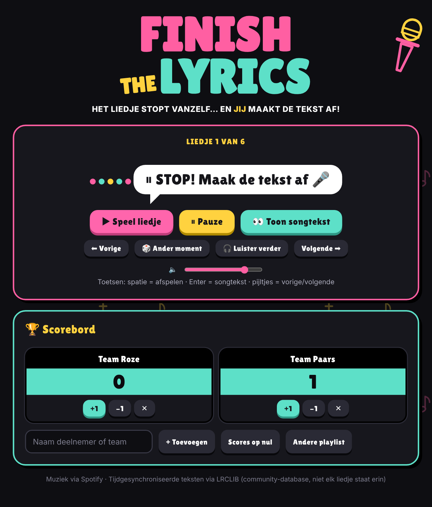
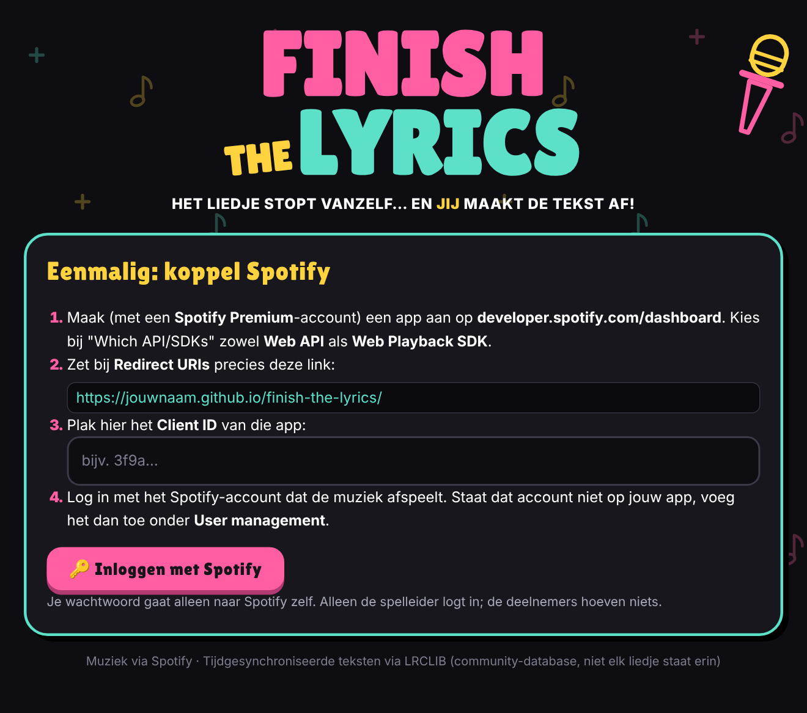
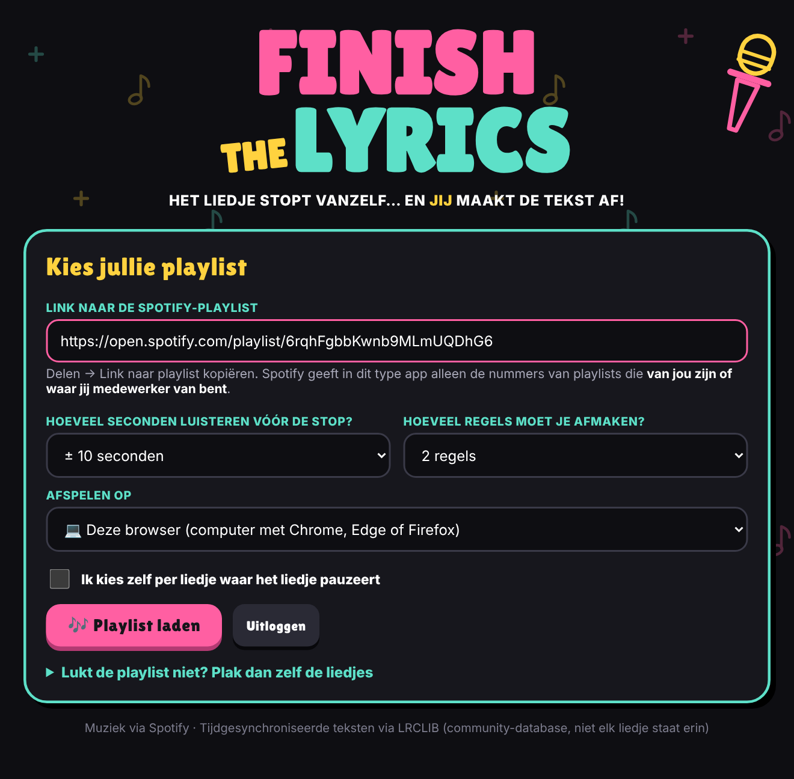
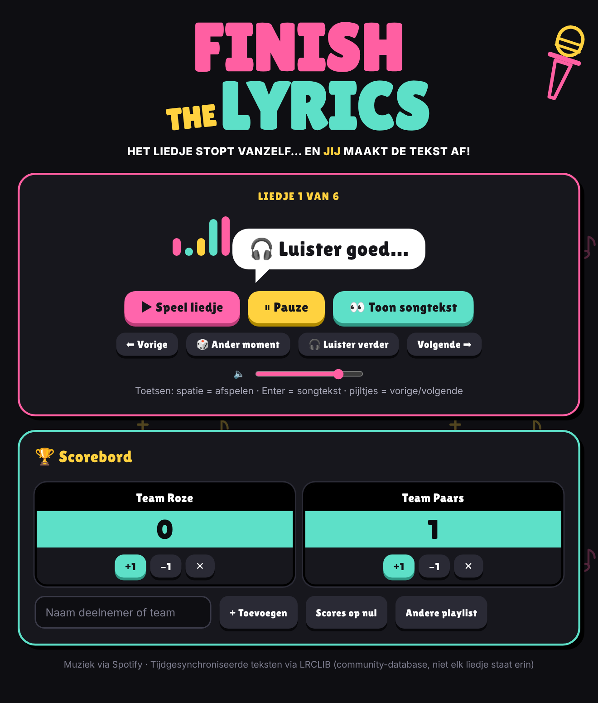
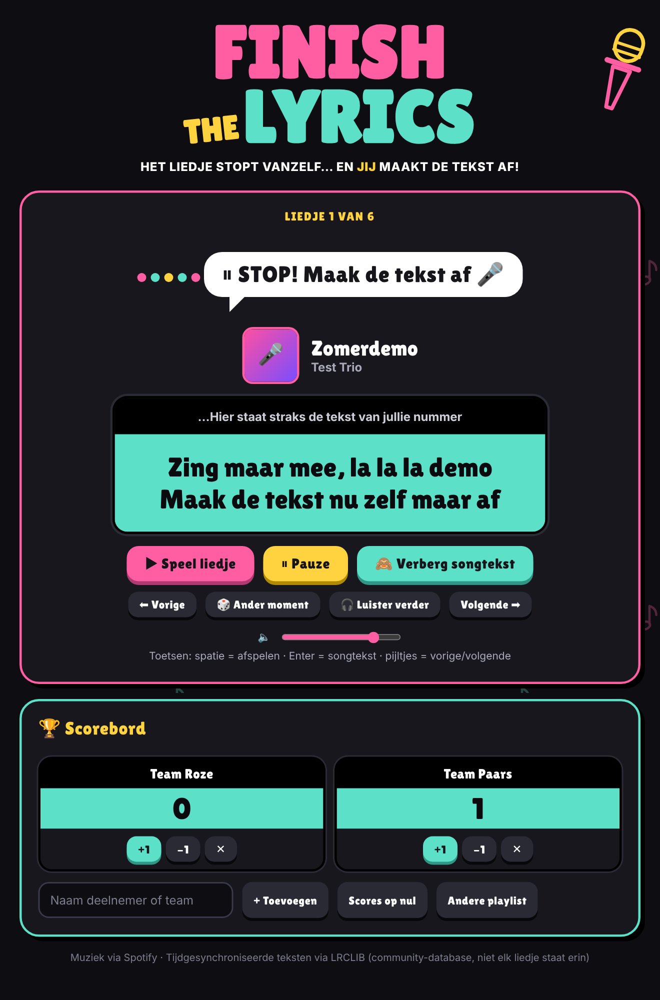
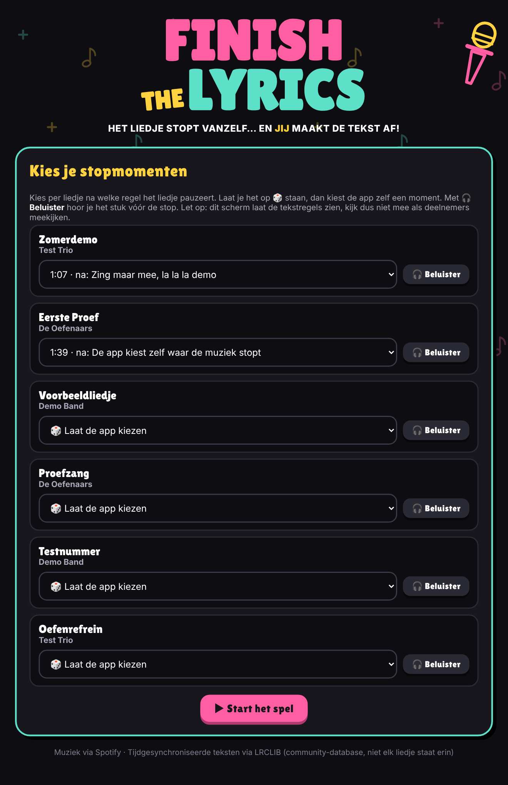
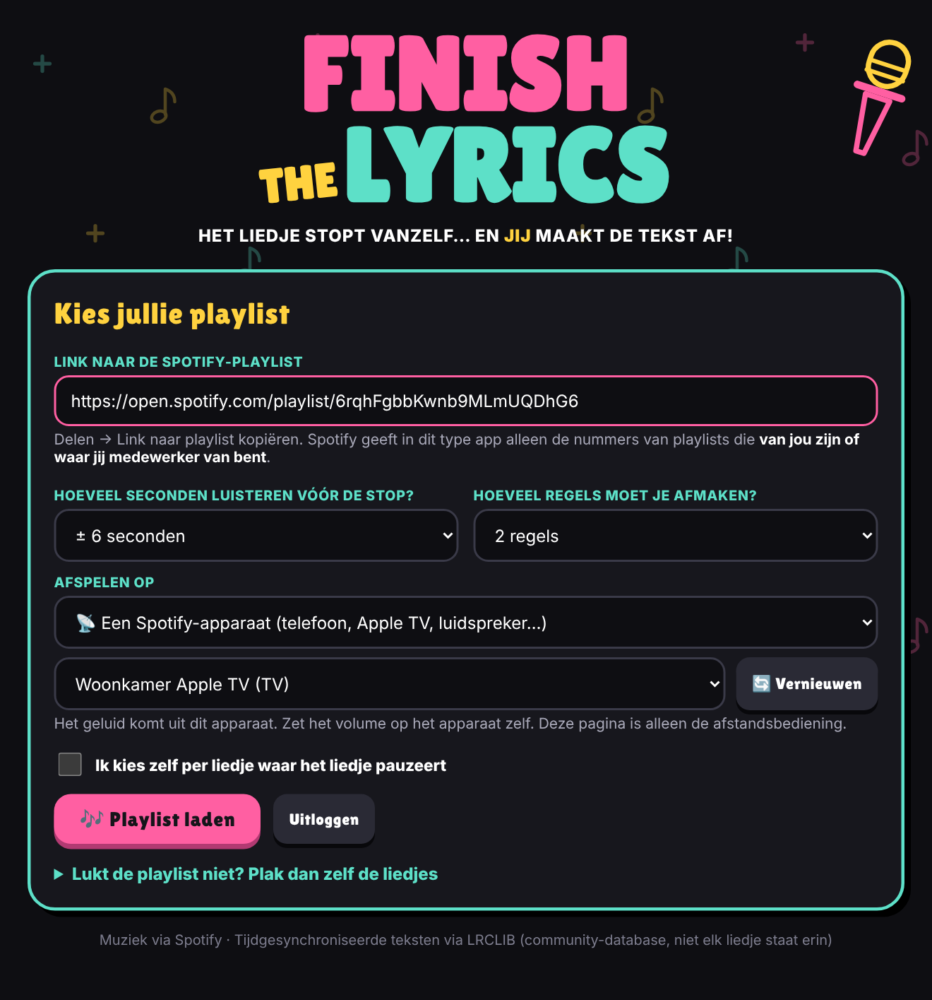

# 🎤 Finish the lyrics

### ▶ [Speel het spel direct: mmulder82.github.io/finish-the-lyrics](https://mmulder82.github.io/finish-the-lyrics/)

Een muziekspel voor een groepje vriendinnen, een feestje of een clubavond. Het liedje uit jullie Spotify-playlist speelt, **stopt vanzelf midden in de tekst** en een deelnemer maakt de zin af. Daarna drukt de spelleider op één knop en verschijnt de tekst die gezongen had moeten worden.

Je geeft alleen een Spotify-playlist op. De app zoekt zelf de tijdgesynchroniseerde teksten erbij en kiest per liedje een stopmoment.

> De schermafbeeldingen hieronder zijn gemaakt met verzonnen demoliedjes en demoteksten. Bij een echte playlist zie je jullie eigen nummers.

## Zo speel je het

1. De spelleider opent de pagina op een laptop (liefst aan een tv of beamer) en plakt de link van de playlist.
2. Druk op **▶ Speel liedje**. Het liedje begint een paar seconden vóór de stop.
3. Het liedje pauzeert zichzelf. Een deelnemer of team maakt de zin af.
4. Druk op **👀 Toon songtekst**. Je ziet de ontbrekende regels, plus titel, artiest en hoes. Geef een punt in het scorebord.
5. Kies **Volgende ➡** voor het volgende liedje.

De titel blijft verborgen tot je de songtekst toont, zodat het ook een raadspel is.

### Bediening

| Knop | Wat het doet |
|---|---|
| ▶ Speel liedje | Speelt het stuk vóór de stop af (en opnieuw als je nog eens drukt) |
| ⏸ Pauze | Pauzeert of hervat het liedje |
| 👀 Toon songtekst | Laat de ontbrekende regels, titel en artiest zien (en verbergt ze weer) |
| 🎲 Ander moment | Kiest een ander stopmoment in hetzelfde liedje |
| 🎧 Luister verder | Speelt vanaf de stop verder, zodat iedereen het goede antwoord hoort |
| ⬅ Vorige / Volgende ➡ | Wisselt van liedje |

Sneltoetsen: **spatie** = afspelen, **Enter** = songtekst tonen of verbergen, **pijltjes** = vorige of volgende.

In het scorebord krijgt elk team automatisch een eigen kleur (acht kleuren, daarna begint het opnieuw). Met de knop 🎨 bij een team kies je zelf een andere kleur. Teams en scores blijven bewaard in je browser.

Op het beginscherm kies je hoeveel seconden er vóór de stop wordt gespeeld (6 tot 25) en hoeveel regels er moeten worden afgemaakt (1 tot 3).

### Zelf kiezen waar het liedje pauzeert

Standaard kiest de app per liedje zelf een stopmoment. Wil je dat zelf bepalen, vink dan op het beginscherm **"Ik kies zelf per liedje waar het liedje pauzeert"** aan. Na het laden van de playlist zie je een keuzescherm:

- Kies per liedje in de lijst na welke regel het liedje pauzeert. De tijd staat erbij.
- Met **🎧 Beluister** hoor je meteen het stuk vóór die stop.
- Laat je een liedje op **🎲 Laat de app kiezen** staan, dan kiest de app zelf, net als anders.
- Druk op **▶ Start het spel** als je klaar bent.

Dit scherm toont de tekstregels, dus doe dit voordat de deelnemers meekijken. Tijdens het spel kies je met **🎲 Ander moment** een willekeurig ander stopmoment, ook bij een liedje waarvoor je zelf een moment had gekozen. Je keuzes gelden voor deze ronde en worden niet bewaard.

### Afspelen op je telefoon, tablet, Apple TV of een luidspreker

Naast afspelen in de browser (laptop) kun je op het beginscherm bij **Afspelen op** kiezen voor **📡 Een Spotify-apparaat**. De pagina is dan alleen de afstandsbediening en het geluid komt uit een ander apparaat: een iPhone of iPad, een Apple TV met de Spotify-app, een slimme luidspreker, een spelcomputer, enzovoort.

1. Open de Spotify-app op het apparaat waar het geluid uit moet komen en speel daar kort iets af, zodat het apparaat actief is.
2. Kies in het spel **📡 Een Spotify-apparaat** en druk op **🔄 Vernieuwen**.
3. Kies het apparaat in de lijst en speel zoals gewoonlijk.

Het volume stel je in op het apparaat zelf. Op een iPhone of iPad staat deze modus automatisch aan, want de Spotify-speler in de browser werkt daar niet.

**Apple TV:** er is geen Spotify-speler voor Apple TV die deze pagina kan bedienen, maar de Spotify-app op de Apple TV verschijnt wel als apparaat in de lijst. Je speelt dan het geluid via de Apple TV en bedient het spel vanaf een laptop of telefoon. Wil je ook het scherm op de tv, spiegel dan het scherm van je laptop, iPhone of iPad via AirPlay.

**Let op:** in deze modus pauzeert de app met een nauwkeurigheid van ongeveer een halve seconde, iets minder precies dan in de browser. Deze modus is getest met een nagebootst Spotify-apparaat, nog niet met echte apparaten.

### Snelkoppeling op het beginscherm

Op een telefoon of tablet kun je de pagina als snelkoppeling toevoegen (Deel → Zet op beginscherm). Je krijgt dan het microfoon-icoon. De pagina opent daarna gewoon in je browser en niet als losstaande app, omdat inloggen met Spotify op een iPhone niet goed werkt vanuit zo'n losstaande app.

## Schermen

| | |
|---|---|
|  |  |
| **1. Eenmalig Spotify koppelen** | **2. Playlist plakken en instellingen kiezen** |
|  |  |
| **3. Het liedje speelt** | **4. De songtekst, titel en artiest verschijnen** |
|  |  |
| **Optioneel: zelf de stopmomenten kiezen** | **Optioneel: afspelen op een telefoon, Apple TV of luidspreker** |

## Installeren

Je hebt twee dingen nodig: een plek waar de pagina staat (GitHub Pages) en een gratis Spotify-ontwikkelaarsapp. Het is een eenmalige klus.

### 1. Zet de pagina op GitHub Pages

1. Maak op GitHub een nieuwe repository, bijvoorbeeld `finish-the-lyrics`.
2. Upload `index.html`, `manifest.webmanifest` en de drie iconen (`icon-180.png`, `icon-192.png`, `icon-512.png`).
3. Ga naar **Settings → Pages**, kies **Deploy from a branch**, branch `main` en map `/ (root)`.
4. Na een minuut staat de pagina op `https://<jouw-gebruikersnaam>.github.io/finish-the-lyrics/`.

### 2. Maak een Spotify-app

1. Ga met een **Spotify Premium**-account naar [developer.spotify.com/dashboard](https://developer.spotify.com/dashboard) en kies **Create app**.
2. Kies bij "Which API/SDKs are you planning to use?" zowel **Web API** als **Web Playback SDK**.
3. Vul bij **Redirect URIs** precies het adres van je pagina in, inclusief de `https://` en de slash aan het eind. Op het koppelscherm van de app staat het adres dat je moet gebruiken.
4. Staat het Spotify-account waarmee je speelt niet op jouw app, voeg het dan toe onder **User management**.
5. Kopieer het **Client ID**.

### 3. Koppel en speel

1. Open je pagina, plak het Client ID en kies **🔑 Inloggen met Spotify**.
2. Plak de link van je playlist en kies **🎶 Playlist laden**. De app zoekt dan de teksten op. Dat duurt even.
3. Je kunt het Client ID ook vast in het bestand zetten: vul bovenin het script `DEFAULT_CLIENT_ID` in. Het Client ID is geen geheim.

Alleen de spelleider hoeft in te loggen. De deelnemers kijken en luisteren mee.

## Goed om te weten

- **Spotify Premium** is nodig om af te spelen en om de Spotify-app aan te maken. Spotify heeft dit in februari 2026 aangescherpt.
- **Computer met Chrome, Edge of Firefox** voor afspelen in de browser. Op een telefoon of tablet kies je **Een Spotify-apparaat** (zie hierboven).
- **Maximaal 5 gebruikers per Spotify-app** in de ontwikkelaarsmodus.
- **De playlist moet van jou zijn, of een gedeelde playlist waar jij medewerker van bent.** Spotify geeft de nummers van andermans playlist niet vrij. Maak anders een eigen kopie (alle nummers selecteren en toevoegen aan een nieuwe playlist), of plak onder **Lukt de playlist niet?** de liedjes als `Titel - Artiest`.
- **Niet elk liedje heeft een geschikte tekst.** De teksten komen van [LRCLIB](https://lrclib.net), een community-database met tijdstempels per regel. Liedjes zonder zulke tekst worden overgeslagen en onderaan getoond. Nederlandstalige en heel nieuwe nummers vallen vaker af.
- **De stop is niet tot op de milliseconde.** De app pauzeert iets eerder, omdat pauzeren even duurt (via een Spotify-apparaat ongeveer een halve seconde). Soms klopt de tijdstempel van een andere versie van het nummer niet helemaal. Kies dan **Ander moment** of ga naar het volgende liedje.

## Problemen oplossen

| Melding of probleem | Oplossing |
|---|---|
| "Inloggen is niet gelukt" of Spotify meldt "Invalid redirect URI" | Het adres bij Redirect URIs moet precies kloppen, ook de slash aan het eind. Controleer ook het Client ID. |
| "Afspelen in de browser kan alleen met Spotify Premium" | Log in met een Premium-account. |
| "Spotify geeft de nummers van deze playlist niet vrij" | Maak een eigen kopie van de playlist of plak de liedjes zelf. |
| "Bij geen enkel liedje is een tijdgesynchroniseerde tekst gevonden" | Probeer een playlist met bekendere (vaak Engelstalige) nummers. |
| In de lijst met apparaten staat mijn telefoon of Apple TV niet | Open de Spotify-app op dat apparaat, speel kort iets af en kies **🔄 Vernieuwen**. Zorg dat het apparaat met hetzelfde Spotify-account is ingelogd. |
| De knop ▶ blijft grijs | Wacht even tot de Spotify-speler is gestart. Werkt het niet, probeer dan Chrome of Edge op een computer. |
| "Je login is verlopen" | Kies **Uitloggen** en log opnieuw in. |

## Privacy

- De app heeft geen eigen server. Alles draait in je browser.
- Inloggen gaat via de officiële Spotify-inlogpagina. Je wachtwoord komt nooit bij deze app.
- Het inlogtoken, het Client ID, je laatste playlistlink en het scorebord staan alleen in de opslag van je eigen browser. **Uitloggen** wist het token.
- Bij het zoeken van teksten stuurt de app titel, artiest, albumnaam en duur van een nummer naar LRCLIB.

## Technisch

- Eén bestand (`index.html`), zonder build of afhankelijkheden. Het lettertype [Lilita One](https://fonts.google.com/specimen/Lilita+One) (SIL Open Font License 1.1) zit erin ingebouwd, dus er worden geen lettertypen van een andere site geladen.
- Inloggen via Spotify met PKCE, nummers uit de Spotify Web API, afspelen met de Spotify Web Playback SDK (browser) of via Spotify Connect (ander apparaat).
- Het stopmoment komt uit de tijdstempels van de tekst: de app kiest een plek waar de zang direct daarna verdergaat. Regels die vaker in het liedje voorkomen (het refrein) krijgen voorrang.
- De schermafbeeldingen zijn gemaakt met nagebootste antwoorden van Spotify en LRCLIB en verzonnen demodata.

## Licentie

De code is beschikbaar onder de [MIT-licentie](LICENSE). Het ingebouwde lettertype valt onder zijn eigen licentie (SIL Open Font License 1.1). Voor Spotify en LRCLIB gelden hun eigen gebruiksvoorwaarden.

Deze app is niet gelieerd aan Spotify of LRCLIB. Spotify is een handelsmerk van Spotify AB.
